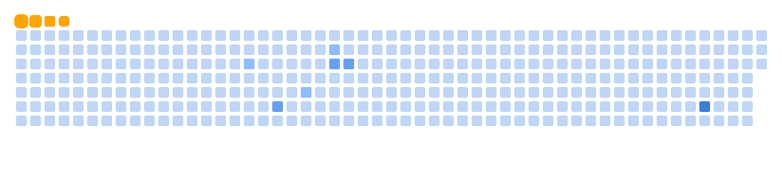

<div align="center">

# `alifnaufaldo`

**full-stack & systems engineer · Jakarta, ID**

<a href="https://github.com/AlifNaufaldo">
  
</a>

</div>

```text
$ whoami
Muhammad Alif Naufaldo — full-stack engineer with a business management background.
I translate messy operational workflows into typed, low-latency production systems.

$ status
→ shipping full-stack platforms in TypeScript, Next.js, and PostgreSQL
→ building concurrent, low-latency backends in Rust (Actix-web, Tokio) & Go
→ wiring multimodal LLM pipelines, MCP tooling, and CLI automation into real workflows
```

### `> highlighted_work`

| system | stack | impact |
| :--- | :--- | :--- |
| **Real-Time Telemetry & CAT Engine** | `Rust` `Actix-web` `Tokio` `WebSockets` | Built a live proctoring & exam engine backed by `tokio::sync::broadcast`, benchmarked at **1,000+ concurrent candidates**. |
| **Enterprise Ops & Financial ERP** | `Next.js` `PostgreSQL` `Prisma` `Gemini API` `Zod` | Automated supplier invoice ingestion via multimodal OCR into Zod-validated schemas and ACID-compliant transactions. |
| **Production Web Platforms** | `TypeScript` `Next.js` `TanStack` `Tailwind` | Engineered data-heavy interfaces with strict client-side validation and **95+ Core Web Vitals**. |

### `> tech_stack`

<p>
  
</p>

`systems & backend` Rust (Actix-web, Tokio) · Go · Node.js · NestJS · WebSockets<br />
`frontend & ui` TypeScript · React · Next.js (App Router) · TanStack · Tailwind CSS<br />
`data & ai tooling` PostgreSQL (Prisma, SeaORM) · Redis · Docker · Playwright · MCP · Gemini / Claude CLI

### `> fun_facts`

- `if err != nil` is a love language
- the borrow checker is my strictest code reviewer—and it's usually right
- terminal-first: if a workflow runs twice, it becomes a script or an MCP tool

<div align="center">

### `> contribution.exe`



<br />

<sub><i>// TODO: touch grass</i></sub>

</div>
